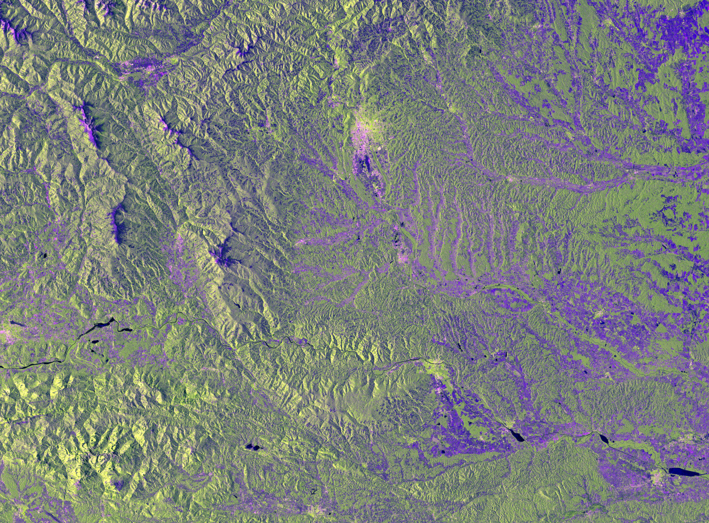

# SAR terrain correction from scratch

Turns a Sentinel-1 IW GRD product into an
orthorectified, radiometrically calibrated, terrain-flattened GeoTIFF. Pure Python,
NumPy plus rasterio and pyproj, no SNAP, no GAMMA.

See the blog: https://raphi-web.github.io/sar_terrain_correction/

| Check (against the product's own grid) | Result |
|---|---|
| Slant range | **0.2 mm** max |
| Azimuth line | **0.191 px** max |
| Range pixel | **0.0153 px** max |

The 0.19 px azimuth residual is the grid's own time quantization (0.28 ms), not the solver.
## Known limitations

- Cosine terrain correction only, not the full area based RTC from Small (2011).
- No thermal noise removal, no antenna pattern, no TOPS deramping.
- Ellipsoid heights throughout, no geoid.
- GRD only: no phase, so no polarimetric decomposition and no interferometry.
- No speckle filtering in the products; multi-looking only helps if the output grid is
  also coarsened.
- Tests are pinned to the included demo scene.


## Install

```bash
python -m venv .venv && . .venv/bin/activate
pip install -r requirements.txt
```

Python 3.12 or newer. Tested with numpy 2.5, rasterio 1.5, pyproj 3.7.


## Command line
A small orthorectified AOI:

```python
from sargeo import ortho

stats = ortho.run_aoi("dem.tif", "measurement/....tiff", "out.tif",
                      col0=3500, row0=1800, w=1000, h=1000)
```

```bash
# one command: builds the meta cache on first use, reuses it afterwards
python -m sargeo.cli run --safe path/to/S1D_....SAFE \
                          --dem dem.tif --out product.tif

python -m sargeo.cli run ... --aoi 3500 1800 1000 1000    # DEM pixel window
python -m sargeo.cli run ... --pol vh                     # other polarisation
python -m sargeo.cli run ... --meta ./cache --refresh-meta # explicit / forced cache

# optional: build the cache by itself, e.g. to inspect the range residual
python prepare_meta.py path/to/S1D_....SAFE
```


`--aoi` is a window in DEM pixels omit it to process the full scene footprint.

Output bands are `dn`, `sigma0` and `gamma0`

## Data

Two inputs, both public:

1. **Sentinel-1 IW GRD** in the COG SAFE layout, from [Copernicus Data Space](https://dataspace.copernicus.eu/).
   Unzip it so the `.SAFE` folder sits next to `sargeo/`.
2. **Copernicus DEM GLO-30**, reprojected to the UTM zone of the scene, saved as `dem.tif`.

## What is implemented

| Module | Function |
|---|---|
| `sargeo/ellipsoid.py` | geodetic to ECEF, WGS84 |
| `sargeo/orbit.py` | cubic Hermite interpolation of the 17 orbit state vectors |
| `sargeo/srgr.py` | slant range <-> ground range via the 28 per-second polynomial sets |
| `sargeo/geo.py` | zero-Doppler acquisition time (bisection on `(S-P)·V`) |
| `sargeo/ortho.py` | per map pixel inverse geocoding, bilinear resampling, GeoTIFF output |
| `sargeo/terrain.py` | DEM surface normals, signed projected incidence, layover and shadow masks (horizon walk) |
| `sargeo/radiometry.py` | calibration lookup, DN to sigma0, cosine terrain flattening |
| `sargeo/safeparse.py` | parse any COG SAFE annotation into the `meta/` cache |
| `sargeo/product.py` | scene extent and the chunked multiband writer |
| `sargeo/cli.py` | `prepare-meta` and `run` subcommands |


## Run the tests

```bash
python tests/test_l1_orbit.py     # 5 tests
python tests/test_l2_srgr.py      # 5
python tests/test_l3_geo.py       # 5
python tests/test_l4_ortho.py     # 4
python tests/test_l5_terrain.py   # 6
python tests/test_l6_radiometry.py # 5
python tests/test_l9_pipeline.py   # 4  (SAFE parser, scene extent, CLI parity)
```

Or all at once, from the repo root:

```bash
python -m pytest
```


## License

GPL-2.0. ESA SNAP (GPL) was used as a behavioural reference while writing this code;
no SNAP source code was copied.
