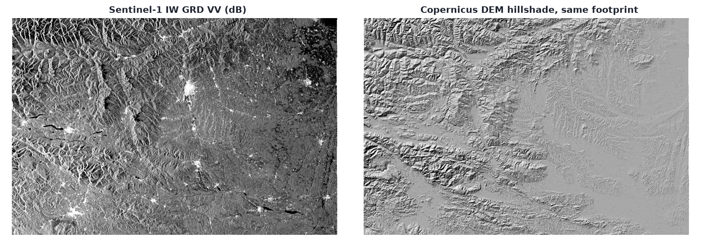
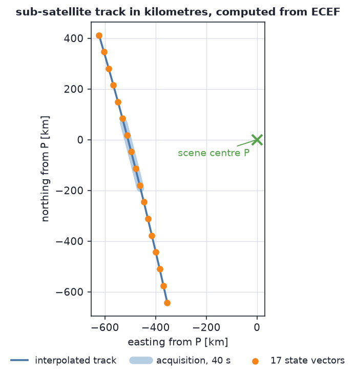

# I am scared of SAR 

And I wanted to change that. So I picked an over-the-top exercise that gave me a few headaches along the way. But I learned a lot, and it did make Synthetic Aperture Radar less scary.
**So let me show you how you can terrain correct your own Sentinel-1 GRD products from scratch using Python, NumPy and Rasterio!**

## Why do we need terrain correction anyway?

The scene I am working with is an ascending orbit Sentinel-1 GRD product, downloaded from ESA Copernicus.
GRD means that the radar image is already projected onto the WGS84 ellipsoid, a smooth Earth with no terrain on it.
It has also been multi-looked, which means adjacent pixels were averaged together to smooth out speckle noise.  


The exact file I am working with:  
`S1D_IW_GRDH_1SDV_20261031T165004_20261031T165029_005262_00A00B_5EE3_COG.SAFE`

The figure below shows the S1 image on the left and a Digital Elevation Model on the right.
Notice that the mountains look kinda distorted? That's because of the side-looking nature of SAR. 
With SAR we are not looking straight down (orthogonal) on the landscape, we are looking from the side. 
This causes **Foreshortening** effects. My goal is to use the DEM to correct these effects.




## Refresher in Radar Geometry

Everything in this post comes down to solving one equation:

$$(S(t) - P)\cdot V(t) = 0$$

- $S(t)$ is where the satellite is at time $t$, a position in metres.
- $P$ is the ground point we are curious about. Also a position in metres.
- $V(t)$ is the satellite velocity at that same instant, in metres per second.


$S - P$ points from the ground up to the satellite, so $\lVert S - P \rVert$ is the slant range, 
and $(S - P)\cdot V$ is the rate at which that distance changes. 
It reaches zero at the closest approach, when the range stops shrinking and starts growing again. 
That instant is the azimuth time, and it is the coordinate we will spend most of this post chasing.

SAR does not have the classical X, Y coordinates. We work with azimuth and range.[^ranges]

[^ranges]: For flat terrain there are actually two ranges. **Slant range** is the straight line from the object to the radar antenna, and it is what actually gets measured. **Ground range** is the horizontal distance from the nadir.

Azimuth really is a time, not a distance. In a naive sense it is the time the Doppler equation equals zero.
Range is the distance from the antenna to the target, obtained from the delay of the echo. 

**In our little spaceship we don't actually record a target's azimuth time and slant range. We record the echoes. The radar transmits a pulse, and after each one it samples the returning energy.**   
**Fast time (within a pulse): gives the delay which lets us calculate the slant range**  
**Slow time (from pulse to pulse): gives the Doppler history so we can calculate the azimuth**

## Parsing the XML

A SAFE folder is mostly one big tiff, but the information lives in the XML. The measurement tiff holds the numbers, and the annotation gives the position.

```
S1D_..._COG.SAFE/
  annotation/
    s1d-iw-grd-vv-....xml             geometry: orbit, grid, polynomials
    calibration/calibration-...xml    the DN to sigma0 lookup
  measurement/s1d-iw-grd-vv-....tiff  the pixels, with no georeferencing at all
```

Four blocks carry everything I need:

- `imageInformation`: `productFirstLineUtcTime` (the time of line 0), `azimuthTimeInterval`, `numberOfLines`, `numberOfSamples`
- `orbitList`: 17 state vectors, position and velocity in Earth Centred Earth Fixed, 10 seconds apart. 
- `coordinateConversionList`: 28 polynomial sets mapping slant range to ground range, one per second of azimuth time
- `geolocationGridPointList`: 210 points with latitude, longitude, height, line, pixel and incidence. ESA ships them for calibration. I use them as a test suite.

I extracted the data from the XML files into a small cache `meta/`. This holds the orbit and polynomials. 

## Coordinate Conversion Time, what fun

We start with `ellipsoid.py`, because we have to work vectors not latitude and longitude. 
The `orbitList` from the annotation is already in ECEF, Earth Centred Earth Fixed, in metres. Our DEM is not. It's in UTM , so it has to be converted: UTM → lon/lat → ECEF. The first step is a pyproj `Transformer`. The second one I wrote myself, and it starts with the WGS84 ellipsoid:

$$a = 6\,378\,137\ \text{m}, \qquad b = 6\,356\,752.314\ \text{m}, \qquad e^{2} = 1 - \frac{b^{2}}{a^{2}}$$


From those we get $N$, the radius of curvature in the prime vertical, a length of about 6.4 million metres:

$$N(\varphi) = \frac{a}{\sqrt{1 - e^{2}\sin^{2}\varphi}}$$

Then the point itself:

$$x = (N + h)\cos\varphi\cos\lambda$$

$$y = (N + h)\cos\varphi\sin\lambda$$

$$z = \big(N(1 - e^{2}) + h\big)\sin\varphi$$

with latitude $\varphi$, longitude $\lambda$, and $h$ the **ellipsoidal** height in metres.

The $N$ in $x$ and $y$, but $N(1-e^{2})$ in $z$: geodetic latitude is defined by the surface normal, and on a squashed ellipsoid that normal does not pass through the centre. Get it wrong and the point lands consistently wrong, which is the worst kind of geodesy bug, because nothing crashes and the picture still looks fine.

In code that is one call. The algebra above is the entire function.

```python
P = lla2ecef(lat, lon, h)     # (N, 3) ECEF, metres
```

One caveat: the 210 geolocation points carry ellipsoidal heights. 
The Copernicus DEM carries orthometric heights, measured from the EGM2008 geoid, which sits roughly 47 m above the 
ellipsoid over Austria. Feed those in unchanged and every point lands 47 m low, 
which shifts it about 67 m horizontally at 35° incidence. 
The fix is a one-time conversion: add the geoid height to every DEM pixel. `prepare_dem.py` does that with pyproj and 
writes `dem_ellipsoidal.tif`, and the geoid height ranges from 44 to 50 m across the scene.
The SAR image itself agrees: adding a constant offset to the old DEM, the terrain lines up best with the radar at +47 m.

## Interpolating position and velocity

We have 17 satellite positions and velocities, 10 seconds apart. That table is the entire description of the orbit inside the product.



The orange dots are the 17 state vectors, 10 seconds apart, so the table covers 160 seconds of orbit. The thick part of the line is the 40 second acquisition window of this scene. The scene centre P sits about 490 km to the east of the track, which is not a plotting mistake: the radar looks sideways, so it images ground it never flies over. The near edge of this swath is at 30.3° incidence, and at this altitude that lands roughly 490 km from nadir, which is where the scene begins.

### Why we need a function, not 17 points

Every ground point is imaged at a different instant. The radar looks sideways and the satellite keeps moving, so a point sits at broadside for one moment only. The next chapter asks, for each of them, "where was the satellite at that moment?", and the answer has to exist for times that are not in the table. The 17 samples have to become a function before anything else can happen.

I know cubic Hermite sounds like a nightmare. Stay with me, because it is ten lines of code. Someone way smarter than you and me already figured it out. Our job is just to translate the math into code.

### Why not a straight line

The satellite is in free fall around the Earth, about 8 m/s². Over a 10 second gap a straight chord misses the real trajectory by roughly

$$\frac{1}{8}\,a\,\Delta t^{2} \approx 102\ \text{m}$$

My tolerance for the whole geometry is 0.1 m, so getting the value right is not enough. The interpolant has to get the slope right too.

### Why Hermite, and why velocity is not optional

Each state vector ships a position and a velocity. Each end of a segment therefore gives two constraints: a value and a slope. Four constraints, four coefficients, one cubic. Cubic Hermite is the smallest interpolant that uses both, and by construction it passes exactly through every sample.

It also gives us $V(t)$, which we need anyway. The zero Doppler equation is

$$(S(t) - P)\cdot V(t) = 0$$

so the same spline that positions the satellite also decides when it looked at a given point. Interpolation here is half of the equation that will geolocate every pixel.

**SNAP does not use Hermite**. It interpolates the orbit with an 8 point Lagrange polynomial over the neighbouring state vectors, 
and it interpolates the velocities with the same weights instead of differentiating the position curve ([OrbitStateVectors.java](https://github.com/senbox-org/s1tbx/blob/master/s1tbx-commons/src/main/java/org/esa/s1tbx/commons/OrbitStateVectors.java), 
the method is `getPositionVelocity`). Two reasons I still went with Hermite: it is local, so a query time only needs the two vectors that bracket it, and it uses the velocity as a slope constraint 
instead of treating it as a second series to be interpolated. The check at the end of this chapter is what decides whether my choice was good enough.

### Position $S(t)$

First find the 10 second segment that contains our query time.

```python
i = np.searchsorted(t_orb, t) - 1      # last sample at or before t
i = np.clip(i, 0, len(t_orb) - 2)      # keep the bracket inside the table
```

Then the segment length, and the local time scaled into $[0, 1]$.

```python
h = t_orb[i + 1] - t_orb[i]
s = (t - t_orb[i]) / h                 # 0 at the left node, 1 at the right
s_ = s[:, None]                        # trailing axis: (N,) weights times (N,3) vectors
```

The interpolation happens in $s$, so the tangents have to be expressed in $s$ as well. A velocity in m/s becomes a tangent in metres by multiplying it with the segment length:

$$m_i = h\,v_i, \qquad m_{i+1} = h\,v_{i+1}$$

Then the four basis polynomials and the point they build:

$$h_{00} = 2s^{3} - 3s^{2} + 1, \quad h_{10} = s^{3} - 2s^{2} + s, \quad h_{01} = -2s^{3} + 3s^{2}, \quad h_{11} = s^{3} - s^{2}$$

$$S(s) = h_{00}\,p_i + h_{10}\,m_i + h_{01}\,p_{i+1} + h_{11}\,m_{i+1}$$

```python
h00 = 2 * s_**3 - 3 * s_**2 + 1
h10 = s_**3 - 2 * s_**2 + s_
h01 = -2 * s_**3 + 3 * s_**2
h11 = s_**3 - s_**2

s_t = h00 * p_i + h10 * m_i + h01 * p_next + h11 * m_next
```

There are two free checks before trusting any of this. At $s = 0$ the weights are $(1, 0, 0, 0)$, so the spline returns $p_i$ exactly. At $s = 1$ it returns $p_{i+1}$. If those fail, nothing downstream can work, so they are also the first assertions in the test file.

### Velocity $V(t)$

Velocity is the same cubic, differentiated. The chain rule brings out the $1/h$:

$$V(t) = \frac{1}{h}\left(h'_{00}\,p_i + h'_{10}\,m_i + h'_{01}\,p_{i+1} + h'_{11}\,m_{i+1}\right)$$

with

$$h'_{00} = 6s^{2} - 6s, \quad h'_{10} = 3s^{2} - 4s + 1, \quad h'_{01} = -6s^{2} + 6s, \quad h'_{11} = 3s^{2} - 2s$$

```python
dh00 = 6 * s_**2 - 6 * s_
dh10 = 3 * s_**2 - 4 * s_ + 1
dh01 = -6 * s_**2 + 6 * s_
dh11 = 3 * s_**2 - 2 * s_

v_t = (dh00 * p_i + dh10 * m_i + dh01 * p_next + dh11 * m_next) / h[:, None]
```

At $s = 0$ only $h'_{10} = 1$ survives, so $V = m_i / h = v_i$. 

### Verifying the interpolation
Using the spline to place all 210 geolocation points, and compare the geometric range with the range the radar measured from the echo delay.

```
max | |S(t) - P| - c * tau / 2 | = 0.219 mm
```
0.2 millimetres over 800 km, at 210 points. If only the buses for my daily commute were that precise.


## It's Doppler Time 
More precisely we need to solve the Doppler equation. For a time $t$ of ground point $P$ we need to find the time when the Doppler equation equals zero. We need this to geolocate a point on the earth with its corresponding SAR image coordinate. 

$$
(\text{OrbitPosition}(t) - \text{GroundPoint}) \cdot \text{SatelliteVelocity}(t) = 0
$$

 This is the instant our satellite directly passes by the object. This can be done using bisection in a few lines of code.  

First we define the Doppler equation in a function:
```python
def f(tt):
    return float(np.dot(orbit.position(tt) - P, orbit.velocity(tt)))
```

All we need to do is define a search interval. Since we start here the lower limit is the first orbit-time we got in `t_orb[0]`. The upper limit is the last orbit-time `t_orb[-1]`.

After that we compute our Doppler equation for the lower limit and look at its sign. If $D(t) > 0$ then the ground point has already passed. If $D(t) < 0$ then the ground point is approaching. We calculate a middle point which is just the average between the lower and upper limit and check if the point is between low-mid or mid-high. We can then use these bounds as our new starting points. We do this 60 times in our code, this gives us an accurate estimation where the Doppler equation equals zero.

```
lo, hi = float(t_orb[0]), float(t_orb[-1]) # search interval
f_lo = f(lo)
for _ in range(60):
        mid = 0.5 * (lo + hi)
        fm = f(mid)
        if (fm > 0) == (f_lo > 0):   # mid has the same sign as lo
            lo, f_lo = mid, fm        # -> root is in [mid, hi]: move lo up
        else:
            hi = mid                  # -> root is in [lo, mid]: pull hi down
return 0.5 * (lo + hi)
```

Now that we can find the zero Doppler time we have all the tools needed to transform a point in latitude, longitude and height to SAR Azimuth and Range.
The next steps are easy convert the lat/lon to ECEF coordinates and find the zero_doppler_time for it.
```python
P = lla2ecef(lat, lon, h) # convert geographic coordinates to earth centered earth fixed
t = zero_doppler_time(P) # find when satellite observed the point
```

Now we can calculate the slant range `np.linalg.norm(orbit.position(t) - P)` this can then be converted to ground range using a Horner polynomial. The coefficients for it are already provided in the metadata.

```
def slant_to_ground(sr: float | np.ndarray, t_az: float) -> np.ndarray:
    """
    converts slant range to ground range
    gr = P(sr - sr_0)
    """
    c = conversion(t_az)  # load conversion parameters
    sr = np.asarray(sr, dtype=float)
    x = sr - c["sr0"]  # polynomial has sr0 as origin.  in-swath 0 <= x <= ~166 km
    v = c["srgr"][-1] # last coefficient in the horner polynomial
    for a in reversed(c["srgr"][:-1]): # evaluate polynomial
        v = v * x + a

    gr = v
    return gr
```
Now all we have to do is to convert the ground range to pixels in order to get the column of our raster image. The metadata also provides a lookup here.
```
tim = io.timing() # load timing metadata
line = (t - tim["t0"]) / tim["dt_az"]
```

**And tada, we can now convert any Point to our Radar Coordinates and vise versa** 

## Aligning the SAR image with the DEM
Now we get into the meat of things! The problem with our doppler time functions is that they are slow when processing a whole image, so we need a vectorized version.

We start out by converting our dem pixels latitude and longitude to the ECEF coordinate system `P = lla2ecef(lat, lon, h)`. Then we obtain our orbits `t_orb, _, _ = io.orbit_arrays()` 
 
Now it is time for our vectorized numpy magic! We use the orbit start and end-time as our initial bounds for the bisection, define a function that calculates the dot product for every point at once, and evaluate the doppler function at the lower boundary:

```python
lo = np.full(len(P), float(t_orb[0]))
hi = np.full(len(P), float(t_orb[-1]))

def f(t):
    S = orbit.position(t)
    V = orbit.velocity(t)
    return np.sum((S - P) * V, axis=1)

f_lo = f(lo)
```

We use 60 iterations to find the azimuth time for each point. `lo` and `hi` are 1D arrays and each value is adjusted independently from its neighbours. In every iteration we calculate the midpoints and evaluate the doppler function on them, then compare the sign against the value stored at the lower boundary: wherever `fm` has the same sign as `f_lo`, the root must lie *above* the midpoint, so we move `lo` up, everywhere else we pull `hi` down. Updating `f_lo` together with the boundary keeps the stored sign in sync, so we never have to re-evaluate a boundary.

```python
for _ in range(60):
    mid = 0.5 * (lo + hi)
    fm = f(mid)
    same = (fm > 0) == (f_lo > 0)
    lo = np.where(same, mid, lo)
    hi = np.where(same, hi, mid)
    f_lo = np.where(same, fm, f_lo)
```

Just like in the scalar version, the answer is the middle of the final bracket:

```python
t = 0.5 * (lo + hi)
```

60 iterations halve the orbit interval by 2^60 that's far beyond what float64 can resolve so the bracket collapses to machine precision after ~30 steps. `t` is now the zero-Doppler acquisition time for every DEM pixel, one vectorized stroke instead of a loop over millions of points.


**And with this we can compute slant range and ground range:**

```python
# Compute slant range.
S = orbit.position(t)
r = np.linalg.norm(S - P, axis=1)

# Convert slant range -> ground range.
T, sets = io.conversions()
sr0 = np.array([s["sr0"] for s in sets])
C = np.array([s["srgr"] for s in sets])

# Find nearest conversion time independently for every pixel.
idx = np.argmin(np.abs(T[None, :] - t[:, None]), axis=1)

# Shift the range origin for numerical stability.
x = r - sr0[idx]
```

With our orbit position `S` the difference vector `S-P` gives the slant range `r`. The metadata provides the ground range polynomial at discrete azimuth times, and we pick the nearest set in time for every pixel; interpolating coefficients between sets would only interpolate fit noise. The shift by `sr0` is for numerical stability, the polynomial is built around `x = r - sr0`, not around `r`. The evaluation of the polynomial terms for all our pixels is a simple for-loop.

```python
gr = np.zeros_like(x)
for i in range(9):
    gr += C[idx, i] * x ** i
```

At the finish line of our vectorized geocode function we have to convert the physical coordinates into SAR image coordinates. We subtract the image start time from the acquisition time and divide by the time between lines. The ground range is on a 10 m grid, so the pixel index is `gr / 10`:

```python
#       line = (acquisition_time - image_start_time)
#              / time_between_lines
#       pixel = ground_range / 10 m

tim = io.timing()

line = (t - tim["t0"]) / tim["dt_az"]
pixel = gr / 10.0

return line, pixel
```

And that's it, our super fast geolocation is implemented.

## Writing the GeoTIFF
We are almost done, I promise! We have to define a function that brings everything together. Our result will be a terrain-corrected GeoTIFF.
We point this function at an elevation model GeoTIFF and our Sentinel-1 GRD file. We can give `col0`, `row0` as the start column and row indexes for the area of interest, as well as `w` and `h` in pixels.

```python
def run_aoi(
    dem_path: str,
    grd_path: str,
    out_path: str,
    col0: int,
    row0: int,
    w: int,
    h: int,
    nodata: int = 0
) -> dict:
```

Reading the DEM is easy thanks to rasterio. Note that `window_transform` returns the transform of the AOI window itself, origin included, so everything downstream is window-relative:

```python
with rasterio.open(dem_path) as ds:
    win = Window(col0, row0, w, h)
    dem = ds.read(1, window=win).astype(float)
    transform = ds.window_transform(win)
    crs = ds.crs
```

We need the center coordinates of our pixels because the geometry lives at pixel centers, not corners, so we add `0.5` to our row and column indices. The columns `[0, 1, 2, ...]` become `[0.5, 1.5, 2.5, ...]`.

```python
cols = np.arange(w) + 0.5
rows = np.arange(h) + 0.5
```

And now with the transform parameters we can get Easting and Northing.

```python
E = transform.c + cols * transform.a
N = transform.f + rows * transform.e
EE, NN = np.meshgrid(E, N)

tf = Transformer.from_crs(
    crs,
    "EPSG:4326",
    always_xy=True
)

lon, lat = tf.transform(
    EE.ravel(),
    NN.ravel()
)
```

We convert whatever CRS our DEM has to EPSG:4326, WGS84, because the orbit and the ECEF math live in geographic coordinates. **And now it's time for our geolocation function**: the DEM pixels' latitude, longitude and height give us the line number and pixel of the SAR image where each ground point was observed. Then we keep a mask of where we actually have valid numbers.

```python
line, pixel = geocode_tile(
    lon,
    lat,
    dem.ravel()
)

ok = np.isfinite(line) & np.isfinite(pixel)
```

Now it's time to sample the SAR image at those positions. I will show the actual reading at the end of this chapter. What matters here is that instead of snapping every point to its nearest SAR pixel, I chose bilinear interpolation.

```python
def sample_bilinear(dn, line, pixel, nodata=0.0):
    # perform bilinear interpolation of sar to dem grid
    hh, ww = dn.shape
    l0 = np.floor(line).astype(np.int64)       # row above
    p0 = np.floor(pixel).astype(np.int64)      # column left
    dl = line - l0                             # 0..1 down the cell
    dp = pixel - p0                            # 0..1 across the cell

    ok = (l0 >= 0) & (l0 + 1 < hh) & (p0 >= 0) & (p0 + 1 < ww)
    l0c = np.clip(l0, 0, hh - 2)               # safe indices for the gather
    p0c = np.clip(p0, 0, ww - 2)

    v00 = dn[l0c, p0c].astype(float)           # top-left
    v01 = dn[l0c, p0c + 1].astype(float)       # top-right
    v10 = dn[l0c + 1, p0c].astype(float)       # bottom-left
    v11 = dn[l0c + 1, p0c + 1].astype(float)   # bottom-right

    out = (v00 * (1 - dl) * (1 - dp) + v01 * (1 - dl) * dp +
           v10 * dl * (1 - dp) + v11 * dl * dp)
    out[~ok] = nodata
    return out
```

The interpolation follows the same vectorized idea as the geocoding:  he first line, `hh, ww = dn.shape`, just unpacks the shape of our SAR chip so we know where the borders are.  Every geocoded point lands inside one cell of the SAR grid, say `line = 3452.7` and `pixel = 912.4`. `l0` and `p0` floor those coordinates to the row above and the column left, the corners of the 2x2 block around the point. `dl = 0.7` and `dp = 0.4` say how far down and how far across the point sits inside that block.

The value is the weighted average of the four corners. Each corner gets the product of the complementary fractions: `v00` gets `(1-dl)*(1-dp)`, `v10` gets `dl*(1-dp)`, and so on. The corner closest to the sample point always carries the largest weight, at `dl = dp = 0` the result is exactly `v00`, and the four weights always sum to 1. So the interpolated value can never fall outside the range of its four neighbours.

The four `dn[...]` lookups are the numpy trick. Fancy indexing with paired index arrays grabs one element per output pixel, `dn[l0c[i], p0c[i]]`, all at once. Two arrays index *pairs*.

Sample is valid only when the full 2x2 block lies inside the image. Negative or NaN coordinates would explode the indexing, so we clip them into the valid range, gather safely, and then `out[~ok] = nodata` overwrites the junk.

The GRD is tens of thousands of lines long while our DEM tile only touches a tilted strip of it, so `run_aoi` computes the bounding box of the geocoded footprint and reads exactly that window:

```python
y0 = max(int(np.floor(np.min(line[ok]))) - 2, 0)
y1 = int(np.ceil(np.max(line[ok]))) + 3
x0 = max(int(np.floor(np.min(pixel[ok]))) - 2, 0)
x1 = int(np.ceil(np.max(pixel[ok]))) + 3
# both coordinates clipped to the image extent, then read Window(x0, y0, x1-x0, y1-y0)
```

Billi near sampling needs the full 2x2 block at the very edge of the footprint, not just its center pixel, so we add a -2 and +3 margin.
`line` and `pixel` refer to the *full* SAR image, while `dn` starts at `(y0, x0)`. 
```python
val = sample_bilinear(dn, line - y0, pixel - x0, nodata=nodata)
out = val.reshape(h, w).astype(np.uint16)
```

The `reshape` at the end restores the flattend arrays back to the dems width and height. We reuse the DEM's own transform and CRS, so the GeoTIFF lands pixel-for-pixel on the elevation model by construction:

```python
with rasterio.open(out_path, "w", driver="GTiff", height=h, width=w,
                   count=1, dtype="uint16", crs=crs,
                   transform=transform, nodata=nodata) as dst:
    dst.write(out, 1)
```

`run_aoi` also returns `valid_frac` and the source window. On my machine a 1000x1000 tile takes about 27 seconds, and the ridge lines in the SAR image land exactly where the DEM hillshade puts them.

**And tada, the terrain-corrected image is on disk.** Map pixel to lon/lat, lon/lat to ECEF, ECEF to zero-Doppler time, time to slant range, range to ground range, and back into a radar pixel, then a bilinear blend and a GeoTIFF that shares the DEM's grid.

## References

Everything here that is not my own measurement comes from these. Numbers in this post come from the run described above; the code and tests are at [github.com/raphi-web/sar_terrain_correction](https://github.com/raphi-web/sar_terrain_correction).

1. **ESA, Sentinel-1 Product Specification** (S1-RS-MDA-52-7441, issue 3.14.1, 2023). The orbit state vectors, the geolocation grid and the coordinate conversion polynomials I parse all come from here. Available from the [SentiWiki product page](https://sentiwiki.copernicus.eu/web/s1-products).
2. **ESA, SentiWiki: Sentinel-1 mission and products.** Instrument, imaging modes, and what a GRD product actually is. Start at [sentiwiki.copernicus.eu/web/s1-mission](https://sentiwiki.copernicus.eu/web/s1-mission).
3. **ESA SNAP, [RangeDopplerGeocodingOp.java](https://github.com/senbox-org/s1tbx/blob/master/s1tbx-op-sar-processing/src/main/java/org/esa/s1tbx/sar/gpf/geometric/RangeDopplerGeocodingOp.java).** The operator behind the Terrain Correction module in the SNAP GUI. Reading it is how I found out that the target product grid is built by inverting per output pixel, not by scattering input pixels forward.
4. **ESA SNAP, [SARGeocoding.java](https://github.com/senbox-org/s1tbx/blob/master/s1tbx-commons/src/main/java/org/esa/s1tbx/commons/SARGeocoding.java).** Zero Doppler time by bisection, slant to ground conversion, and the bistatic delay correction that is skipped for Sentinel-1.
5. **ESA SNAP, [OrbitStateVectors.java](https://github.com/senbox-org/s1tbx/blob/master/s1tbx-commons/src/main/java/org/esa/s1tbx/commons/OrbitStateVectors.java#L65-L110).** The 8 point Lagrange orbit interpolation that SNAP uses where I used Hermite.
6. **ESA SNAP operator help, [Range-Doppler Terrain Correction](https://github.com/senbox-org/s1tbx/blob/master/s1tbx-op-sar-processing-ui/src/main/resources/org/esa/s1tbx/sar/docs/operators/RangeDopplerGeocodingOp.html).** What the dialog actually runs, parameter by parameter.
7. **Copernicus DEM GLO-30.** The elevation model used for the orthorectification in this post. [doi.org/10.5270/ESA-c5d3d65](https://doi.org/10.5270/ESA-c5d3d65).
8. **Cumming, I. G. and Wong, F. H. (2005).** *Digital Processing of Synthetic Aperture Radar Data: Algorithms and Implementation.* Artech House, ISBN 978-1-58053-058-4. Range Doppler processing, zero Doppler geometry and interpolation, with the derivations I skipped here.
9. **Curlander, J. C. and McDonough, R. N. (1991).** *Synthetic Aperture Radar: Systems and Signal Processing.* Wiley, ISBN 978-0-471-85770-9. The classic treatment of geocoding and the Doppler centroid.
