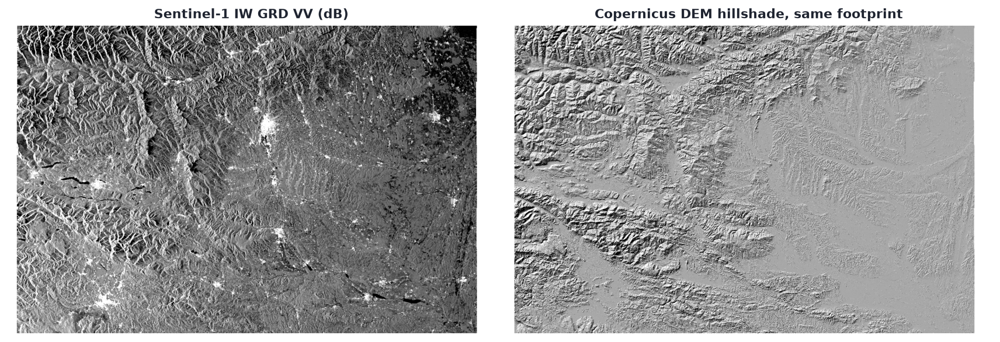

# I am scared of SAR 

And I wanted to change that. For that I picked an over the top exercise that cost me some headache along the way. But I did learn and it did make Synthetic Aperture radar less scary.
**So let me show you how you can terrain correct your own Sentinel-1 GRD products from scratch using Python, NumPy and Rasterio!**

## Why do we need terrain correction anyway?

The scene I am working with is an ascending orbit Sentinel-1 GRD product, downloaded from ESA Copernicus.
GRD means that the radar is already projected onto a flat Earth ellipsoid model (WGS84). 
It has also been multi-looked, which means adjacent pixels were averaged together to smooth out speckle noise.  


The exact file I am working with:  
`S1D_IW_GRDH_1SDV_20261031T165004_20261031T165029_005262_00A00B_5EE3_COG.SAFE`

The figure below shows the S1 image on the left and a Digital Elevation Model on the right.
Notice that the mountains look kinda distorted? That's because of the side-looking nature of SAR. 
With SAR we are not looking straight down (orthogonal) on the landscape, we are looking from the side. 
This causes **Layover** and **Foreshortening** effects. My goal is to use the DEM to correct these effects.




## Refresher in Radar Geometry

Everything in this post comes down to solving one equation:

$$(S(t) - P)\cdot V(t) = 0$$

Three symbols, and they mean exactly this:

- $S(t)$ is where the satellite is at time $t$, a position in metres.
- $P$ is the ground point we are curious about. Also a position in metres.
- $V(t)$ is the satellite velocity at that same instant, in metres per second.

$S - P$ points from the ground up to the satellite, so $|S - P|$ is the slant range, and $(S - P)\cdot V$ is the rate at which that distance changes. It reaches zero at the closest approach, when the range stops shrinking and starts growing again. That instant is the azimuth time, and it is the coordinate we will spend most of this post chasing.

SAR does not have the classical X, Y coordinates. We work with azimuth and range¹.

¹For a flat terrain there are actually two ranges:
- Slant Range: the straight line from object to radar antenna (what actually gets measured)
- Ground Range: the horizontal distance from the nadir

Azimuth really is a time, not a distance. In a naive sense it is the time the Doppler equation equals zero.
Range is the distance from the antenna to the target, obtained from the delay of the echo. 

**In our little spaceship we don't actually record a target's azimuth time and slant range. We record the echoes. The radar transmits a pulse, and after each one it samples the returning energy.**   
**Fast time (within a pulse): gives the delay which lets us calculate the slant range**  
**Slow time (from pulse to pulse): gives the Doppler history so we can calculate the azimuth**

## Parsing the XML

A SAFE folder is mostly XML. The measurement tiff holds the numbers, the annotation holds everything that gives those numbers a position.

```
S1D_..._COG.SAFE/
  annotation/
    s1d-iw-grd-vv-....xml             geometry: orbit, grid, polynomials
    calibration/calibration-...xml    the DN to sigma0 lookup
  measurement/s1d-iw-grd-vv-....tiff  the pixels, with no georeferencing at all
```

Four blocks carry everything I need:

- `imageInformation`: `productFirstLineUtcTime` (the time of line 0), `azimuthTimeInterval`, `numberOfLines`, `numberOfSamples`
- `orbitList`: 17 state vectors, position and velocity in Earth Centred Earth Fixed, 10 seconds apart. 
- `coordinateConversionList`: 28 polynomial sets mapping slant range to ground range, one per second of azimuth time
- `geolocationGridPointList`: 210 points with latitude, longitude, height, line, pixel and incidence. ESA ships them for calibration. I use them as a test suite.

Then the trap that cost me an hour: **all timestamps are UTC, but written without a timezone.** `datetime.fromisoformat()` returns a naive datetime, and `.timestamp()` then reads it as local time. Nothing crashes. The entire scene slides by your UTC offset, and because every timestamp slides together the result still looks perfect on your own machine. It breaks the day somebody in another timezone builds the same cache. I now attach UTC explicitly, and the shipped `meta/` was rebuilt after fixing it.

The reward for parsing carefully is that the product validates itself. Every grid point carries a `slantRangeTime`. Multiply by c/2 and you have a measured range. Interpolate the orbit to the same instant and you have a geometric range. They must agree:

```python
r_meas = 299_792_458.0 * tau / 2.0        # from the echo delay
r_geom = np.linalg.norm(S(t_az) - P)      # from the orbit and the ellipsoid
print(np.abs(r_geom - r_meas).max())      # 0.000219 m
```

0.2 millimetres, over 210 points and 800 km of range. That number told me the parsing was correct, and that every bug after it would be mine and not the file's.
All of it goes into a small cache, `meta/`: one JSON with the orbit and the polynomials, one `.npy` for the grid, one for the times. 60 KB, and the tests stop needing 1.2 GB of tiff.


## Unit Conversion Time, what fun

We start with `ellipsoid.py`, because everything later needs the same thing: a ground point expressed as a vector in the frame the orbit already uses.

The `orbitList` from the annotation is already in ECEF, Earth Centred Earth Fixed, in metres. Our DEM is not. It speaks UTM easting and northing plus a height, so it has to be converted before anything can be compared: UTM → lon/lat → ECEF.

$$a = 6\,378\,137\ \text{m}, \qquad b = 6\,356\,752.314\ \text{m}, \qquad e^{2} = 1 - \frac{b^{2}}{a^{2}}$$


The radius of curvature in the prime vertical, which is a length of about 6.4 million metres. 

$$N(\varphi) = \frac{a}{\sqrt{1 - e^{2}\sin^{2}\varphi}}$$

Then the point itself:

$$x = (N + h)\cos\varphi\cos\lambda$$

$$y = (N + h)\cos\varphi\sin\lambda$$

$$z = \big(N(1 - e^{2}) + h\big)\sin\varphi$$

with latitude $\varphi$, longitude $\lambda$, and $h$ the **ellipsoidal** height, all in metres.

The $N$ in $x$ and $y$, but $N(1-e^{2})$ in $z$: geodetic latitude is defined by the surface normal, and on a squashed ellipsoid that normal does not pass through the centre. Get it wrong and the point lands consistently wrong, which is the worst kind of geodesy bug, because nothing crashes and the picture still looks fine.

In code that is one call. The algebra above is the entire function.

```python
P = lla2ecef(lat, lon, h)     # (N, 3) ECEF, metres
```

One caveat: the 210 geolocation points carry ellipsoidal heights. 
The Copernicus DEM carries orthometric heights, roughly 47 m higher than the 
ellipsoid over Austria. Feed those in unchanged and every point lands 47 m low, 
which shifts it about 67 m horizontally at 35° incidence. 
That is out of scope for this project, and it explains why a product can be geometrically correct 
and still sit a couple of pixels off.

## Interpolating position and velocity

We have 17 satellite positions and velocities, 10 seconds apart. That table is the entire description of the orbit inside the product.

### Why we need a function, not 17 points

Every ground point is imaged at a different instant. The radar looks sideways and the satellite keeps moving, so a point sits at broadside for one moment only. The next chapter asks, for each of them, "where was the satellite at that moment?", and the answer has to exist for times that are not in the table. The 17 samples have to become a function before anything else can happen.

I know cubic Hermite sounds like a nightmare. Stay with me, because it is ten lines of code. Someone way smarter than you and me already figured it out. Our job is just to translate the math into code.

### Why not a straight line

The satellite is in free fall around the Earth, about 8 m/s² of centripetal acceleration. Over a 10 second gap a straight chord misses the real trajectory by roughly

$$\frac{1}{8}\,a\,\Delta t^{2} \approx 102\ \text{m}$$

My tolerance for the whole geometry is 0.1 m, so getting the value right is not enough. The interpolant has to get the slope right too.

### Why Hermite, and why velocity is not optional

Each state vector ships a position and a velocity. Each end of a segment therefore gives two constraints: a value and a slope. Four constraints, four coefficients, one cubic. Cubic Hermite is the smallest interpolant that uses both, and by construction it passes exactly through every sample.

It also gives us $V(t)$, which we need anyway. The zero Doppler equation is

$$(S(t) - P)\cdot V(t) = 0$$

so the same spline that positions the satellite also decides when it looked at a given point. Interpolation here is half of the equation that will geolocate every pixel.

### Position $S(t)$

First find the 10 second segment that contains our query time.

```python
i = np.searchsorted(t_orb, t) - 1      # last sample at or before t
i = np.clip(i, 0, len(t_orb) - 2)      # keep the bracket inside the table
```

Then the segment length, and the local time scaled into $[0, 1]$.

```python
h = t_orb[i + 1] - t_orb[i]
s = (t - t_orb[i]) / h                 # 0 at the left node, 1 at the right
s_ = s[:, None]                        # trailing axis: (N,) weights times (N,3) vectors
```

The interpolation happens in $s$, so the tangents have to be expressed in $s$ as well. A velocity in m/s becomes a tangent in metres by multiplying it with the segment length:

$$m_i = h\,v_i, \qquad m_{i+1} = h\,v_{i+1}$$

Then the four basis polynomials and the point they build:

$$h_{00} = 2s^{3} - 3s^{2} + 1, \quad h_{10} = s^{3} - 2s^{2} + s, \quad h_{01} = -2s^{3} + 3s^{2}, \quad h_{11} = s^{3} - s^{2}$$

$$S(s) = h_{00}\,p_i + h_{10}\,m_i + h_{01}\,p_{i+1} + h_{11}\,m_{i+1}$$

```python
h00 = 2 * s_**3 - 3 * s_**2 + 1
h10 = s_**3 - 2 * s_**2 + s_
h01 = -2 * s_**3 + 3 * s_**2
h11 = s_**3 - s_**2

s_t = h00 * p_i + h10 * m_i + h01 * p_next + h11 * m_next
```

There are two free checks before trusting any of this. At $s = 0$ the weights are $(1, 0, 0, 0)$, so the spline returns $p_i$ exactly. At $s = 1$ it returns $p_{i+1}$. If those fail, nothing downstream can work, so they are also the first assertions in the test file.

### Velocity $V(t)$

Velocity is the same cubic, differentiated. The chain rule brings out the $1/h$:

$$V(t) = \frac{1}{h}\left(h'_{00}\,p_i + h'_{10}\,m_i + h'_{01}\,p_{i+1} + h'_{11}\,m_{i+1}\right)$$

with

$$h'_{00} = 6s^{2} - 6s, \quad h'_{10} = 3s^{2} - 4s + 1, \quad h'_{01} = -6s^{2} + 6s, \quad h'_{11} = 3s^{2} - 2s$$

```python
dh00 = 6 * s_**2 - 6 * s_
dh10 = 3 * s_**2 - 4 * s_ + 1
dh01 = -6 * s_**2 + 6 * s_
dh11 = 3 * s_**2 - 2 * s_

v_t = (dh00 * p_i + dh10 * m_i + dh01 * p_next + dh11 * m_next) / h[:, None]
```

At $s = 0$ only $h'_{10} = 1$ survives, so $V = m_i / h = v_i$. 

### The check that actually matters
Use the spline to place all 210 geolocation points, and compare the geometric range with the range the radar measured from the echo delay.

```
max | |S(t) - P| - c * tau / 2 | = 0.219 mm
```
0.2 millimetres over 800 km, at 210 points. If only the buses for my daily commute were that precise.
